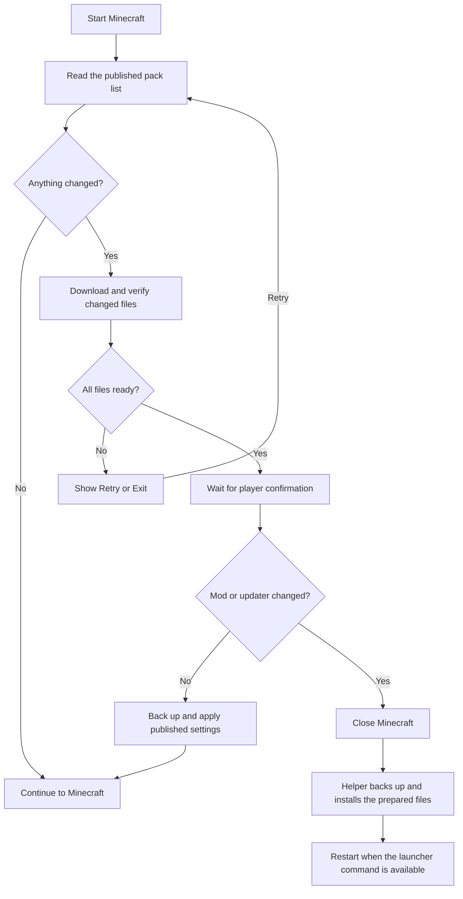
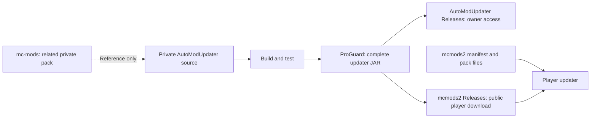

# AutoModUpdater

**Minecraft 1.20.1 · Forge 47.4.10 · Java 17**

Languages: Java, PowerShell, Python, JavaScript, Gradle Groovy, Windows Batch.
Default branch: `1.20.1`. License: [proprietary binary use](LICENSE).

## What Is This Project?

AutoModUpdater keeps a Minecraft mod pack ready to play. It checks the published
mod list, downloads changed files, and installs the settings selected by the pack owner.
This private repository contains the updater source and build tools.

## Why Use It?

- Players install one updater JAR instead of copying every pack update by hand.
- Changed published settings are backed up before replacement.
- Mod changes are installed after Minecraft exits.
- The updater can also install a newer version of itself.
- Players do not need a GitHub account or token for the public pack.

## How Does It Work?

## How Do I Use It?

Download the complete `AutoModUpdater-1.jar` from the
[distribution repository](https://github.com/veyndor1/mcmods2/releases).
Place it in your Forge profile's `mods` folder. Keep only one updater JAR there.
Start the game and follow the update window.

The same complete build is also available in this private repository's
[Releases](https://github.com/veyndor1/AutoModUpdater/releases).
Public downloads are mirrored through `mcmods2` so players need no source access.

The default pack is [mcmods2](https://github.com/veyndor1/mcmods2).
[mc-mods](https://github.com/veyndor1/mc-mods) is a related private repository;
access requires the owner's permission. It is not an automatic fallback download source.

## Detailed Step-by-Step Installation

### For players

1. Install Minecraft 1.20.1 with Forge 47.4.10 and Java 17.
2. Close Minecraft and wait for any previous installer helper to finish.
3. Download `AutoModUpdater-1.jar` from the release selected by the pack owner.
4. Open the game profile folder and then its `mods` folder.
5. Replace an older updater with the downloaded JAR. Do not install a bootstrap JAR
   or an embedded client JAR by itself.
6. Start Minecraft. The updater checks the public pack list before loading mods.
7. If files changed, wait for verification and click **Tamam** (OK) to continue.
   Mod or updater changes close the current game first. If automatic restart is
   unavailable, open the same profile again from your launcher.
8. **Çıkış** (Exit) installs prepared mod updates after exit without restarting.
   A failed download offers **Tekrar dene** (Retry) or Exit.

Themes and reduced motion are available in the updater settings. Local settings
are stored in `config/automodupdater.json` and are excluded from pack publication.

### For the repository owner

1. Clone this private repository, use the `1.20.1` branch and install JDK 17.
2. Run `gradlew.bat build` on Windows, or `sh gradlew build` on other systems.
3. Use `build/libs/AutoModUpdater-1.jar`. The `-release.jar` alias contains the same
   complete distribution: bootstrap, post-exit helper, and embedded GUI mod.
4. Keep `mapping-bootstrap.txt` and `mapping-client.txt` private for debugging.
5. Obtain the existing, separately maintained pack inputs from `mcmods2`:
   compatible mod JARs in `mods-to-host`, and selected settings in `config-to-host`.
6. Run `make-manifest.bat` on Windows with the intended pack inputs. It creates a
   local publication; it does not upload files.
7. Review the result. Upload immutable artifacts first and `server-mods.json` last.
   Keep older hashed artifacts available for downloads already in progress.
8. Increase `version` in `build.gradle` for each new development, build and verify
   the complete JAR, then create a real GitHub Release marked Latest.

Published configuration roots are authoritative: extra files inside those roots
are removed after a backup. Unpublished roots and updater preferences are preserved.
Backups are kept under `.automodupdater/packs/mc-mods2-1.20.1/`; close the game
before restoring them. A root still published by the pack will be synchronized again.

The first upgrade from an older updater without self-update support requires one
manual JAR replacement. The current player distribution version is **1**.

See [security and trust boundaries](SECURITY.md) and
[third-party notices](THIRD_PARTY_NOTICES.md). The
[code protection policy](docs/CODE_PROTECTION.md) explains the distribution boundaries.
