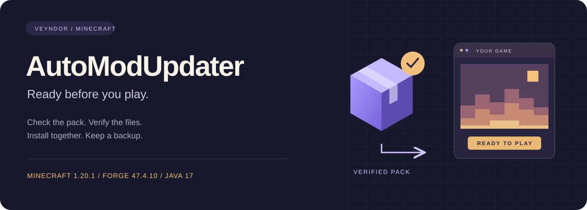
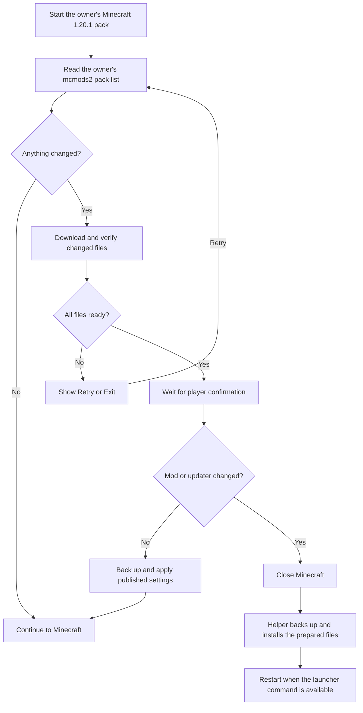
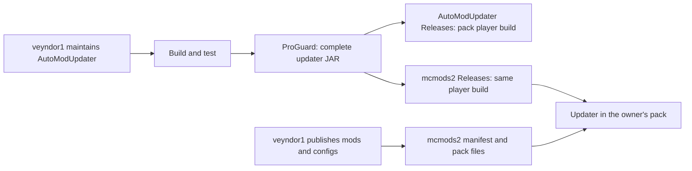

# AutoModUpdater

**Minecraft 1.20.1 · Forge 47.4.10 · Java 17**

Languages: Java, PowerShell, Python, Gradle Groovy, Windows Batch.
Default branch: `1.20.1`. License: [proprietary binary use](LICENSE).

## What Is This Project?

AutoModUpdater is **veyndor1's updater for the owner-managed `mcmods2` pack**.
This build targets Minecraft 1.20.1 and reads the mods and settings published in
[veyndor1/mcmods2](https://github.com/veyndor1/mcmods2).

Only the repository owner controls what is published to that pack. Players using
the owner's pack can download those updates; downloading this mod does not let
someone manage the pack or publish their own updates to `mcmods2`.
This is not offered as a general-purpose updater service for independent packs.

This repository contains the source and build tools and is public at the owner's
request. The [proprietary license](LICENSE) still applies.

## Why Use It?

- Players of the owner's `mcmods2` pack install one updater JAR instead of copying
  each pack update by hand.
- Changed published settings are backed up before replacement.
- Mod changes are installed after Minecraft exits.
- The updater can also install a newer version of itself.
- Pack players do not need a GitHub account or token to download the owner's
  published files. Download access does not grant publishing access.

## How Does It Work?





## How Do I Use It?

Use this build only when joining **the owner's `mcmods2` pack** and following
the owner's pack instructions. Installing it in an unrelated profile can download
this pack's mods and replace its published configuration roots.

Download the complete `AutoModUpdater-2.0.jar` from the
[distribution repository](https://github.com/veyndor1/mcmods2/releases).
Place it in your Forge profile's `mods` folder. Keep only one updater JAR there.
Start the game and follow the update window.

The same complete build is also available in this repository's
[Releases](https://github.com/veyndor1/AutoModUpdater/releases).
Both release pages distribute the build for the same owner-managed pack.

The compiled default feed is
`https://raw.githubusercontent.com/veyndor1/mcmods2/main/server-mods.json`.
The expected pack identity is `mc-mods2-1.20.1`.

The separate `mc-mods` repository is for **Minecraft 1.12.2**. It is outside this
project's scope; this repository does not provide a 1.12.2 build or integration.

## Detailed Step-by-Step Installation

### For players of the owner's pack

1. Confirm that you are using the owner's `mcmods2` pack, then install Minecraft
   1.20.1 with Forge 47.4.10 and Java 17 as instructed by the owner.
2. Close Minecraft and wait for any previous installer helper to finish.
3. Download `AutoModUpdater-2.0.jar` from the release selected by the pack owner.
4. Open the game profile folder and then its `mods` folder.
5. Replace an older updater with the downloaded JAR. Do not install a bootstrap JAR
   or an embedded client JAR by itself.
6. Start Minecraft. The updater checks the public pack list before loading mods.
7. If files changed, wait for verification and click **Tamam** (OK) to continue.
   Mod or updater changes close the current game first. If automatic restart is
   unavailable, open the same profile again from your launcher.
8. **Çıkış** (Exit) installs prepared mod updates after exit without restarting.
   A failed download offers **Tekrar dene** (Retry) or Exit.

Themes and reduced motion are available in the updater settings. Local settings
are stored in `config/automodupdater.json` and are excluded from pack publication.

### For the repository owner

1. As the pack maintainer, use this repository's `1.20.1` branch and install JDK 17.
2. Run `gradlew.bat build` on Windows, or `sh gradlew build` on other systems.
3. Use `build/libs/AutoModUpdater-2.0.jar`. The `-release.jar` alias contains the same
   complete distribution: bootstrap, post-exit helper, and embedded GUI mod.
4. Keep `mapping-bootstrap.txt` and `mapping-client.txt` private for debugging.
5. Obtain the existing, separately maintained pack inputs from `mcmods2`:
   compatible mod JARs in `mods-to-host`, and selected settings in `config-to-host`.
6. Run `make-manifest.bat` on Windows with the intended pack inputs. It creates a
   local publication; it does not upload files.
7. Using the owner's authorized GitHub access, review the result. Upload immutable
   artifacts first and `server-mods.json` last to `mcmods2/main`.
   Keep older hashed artifacts available for downloads already in progress.
8. Increase `version` in `build.gradle` for each new development, build and verify
   the complete JAR, then create a real GitHub Release marked Latest.

Published configuration roots are authoritative: extra files inside those roots
are removed after a backup. Unpublished roots and updater preferences are preserved.
Backups are kept under `.automodupdater/packs/mc-mods2-1.20.1/`; close the game
before restoring them. A root still published by the pack will be synchronized again.

### Mandatory mod removals (2.0)

Edit the existing `server-mods.json` directly and add `removeMods` at the top level:

```json
"removeMods": [
  {
    "fileName": "old-mod-1.20.1.jar",
    "name": "Old Mod",
    "reason": "Incompatible with the current pack."
  }
]
```

Only `fileName` is required. Use an exact JAR filename in `mods/`; wildcards and
paths are rejected. Remove that filename from `mods` in the manifest if it is
listed there. Other mods remain untouched. No folder changes or new artifact
uploads are required for a removal-only publication. Publish the edited JSON at
the existing feed address (the default uses a hyphen: `server-mods.json`).

The **Ayrılanlar** view shows filenames, reasons and the pending removal state.
After the complete release is verified, Continue or Exit closes the game and the
helper moves the matching local JARs into
`.automodupdater/packs/mc-mods2-1.20.1/removed-mods/<id>/`. It retains the original
file as a backup. A file changed after verification is preserved and blocks
completion. An absent file needs no action. The updater itself is protected.
Keep entries published while these mods must remain absent; restoring a backup
while its filename is still listed schedules removal again. Older updater builds
ignore this new section, so distribute 2.0 before relying on mandatory removals.
The generator preserves manually edited `removeMods` entries when rebuilding
the same output manifest, and rejects conflicts with published mod downloads.

The first upgrade from an older updater without self-update support requires one
manual JAR replacement. The current player distribution version is **2.0**.

The local `manifestUrl` setting can override the default address, but changing an
address does not grant access to publish in `mcmods2`. This build still validates
its pack identity and Minecraft version; independent pack hosting is not a
supported setup documented by this project.

See [security and trust boundaries](SECURITY.md) and
[third-party notices](THIRD_PARTY_NOTICES.md). The
[code protection policy](docs/CODE_PROTECTION.md) explains the distribution boundaries.
See [repository settings](docs/REPOSITORY.md) for access and branch protection status.
